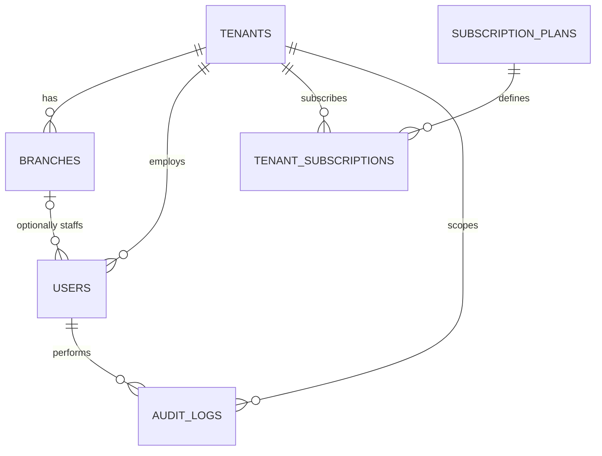
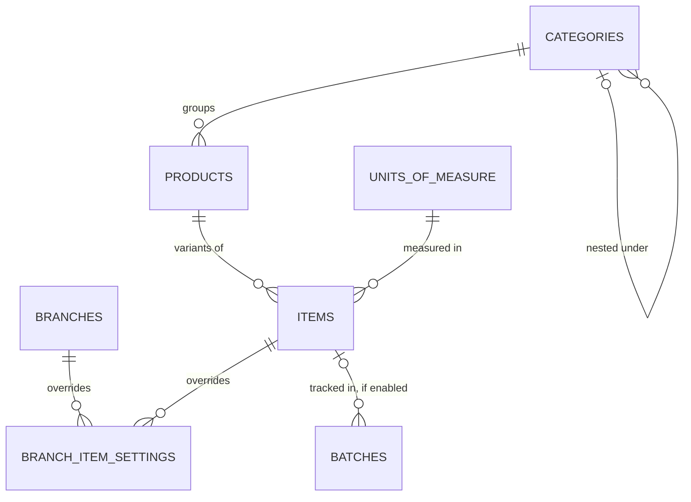
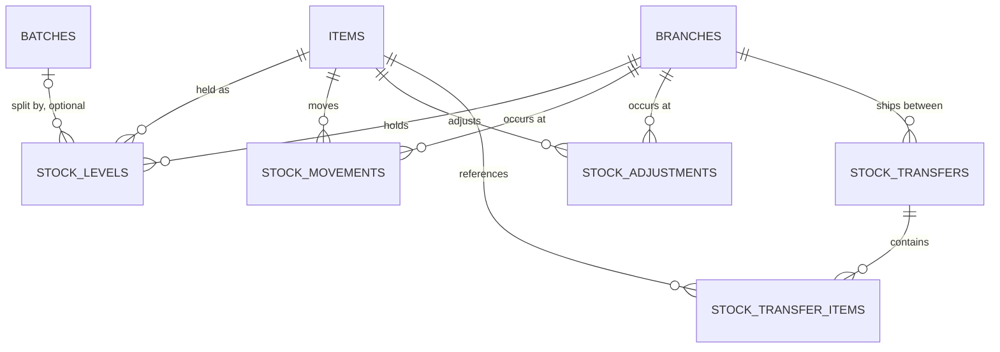
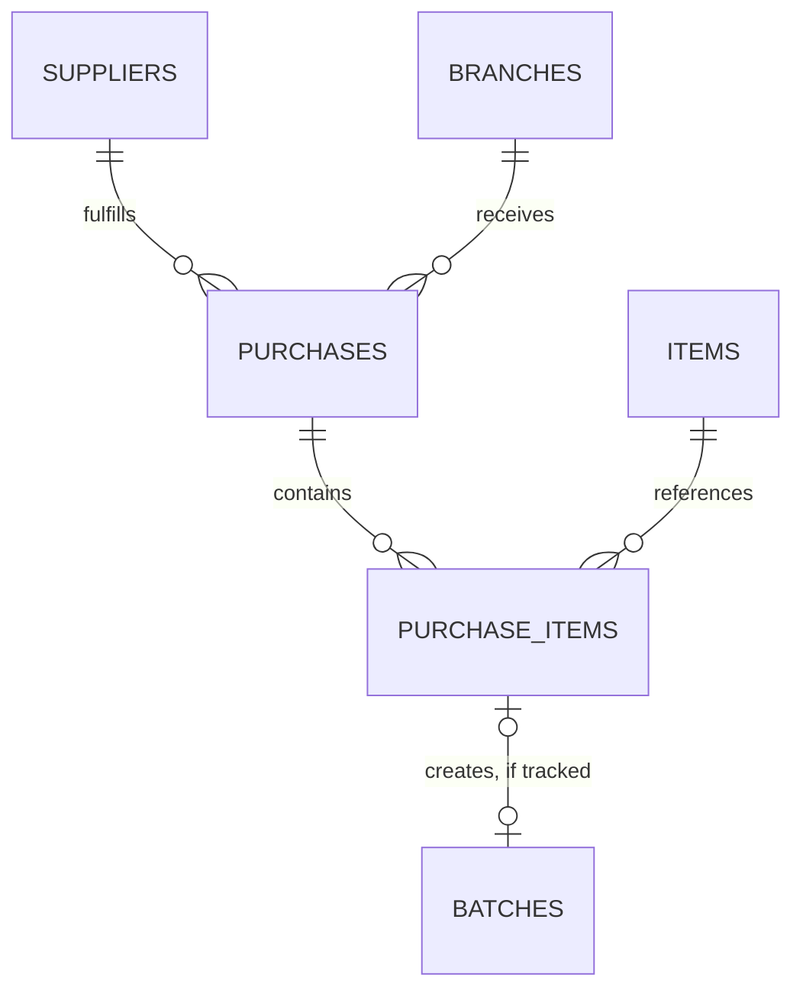
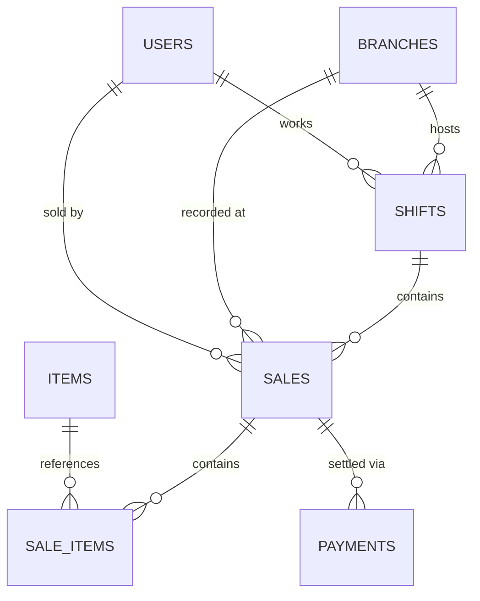
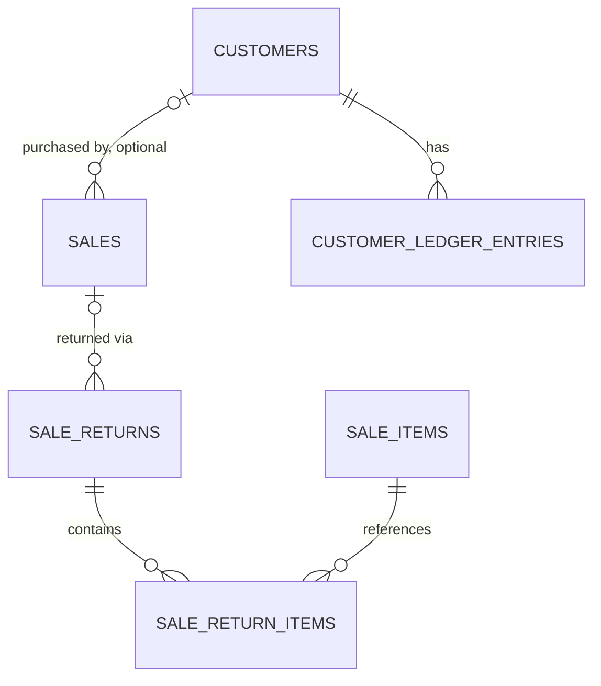

# DigiPlus Inventory Solutions
## Data Model & Entity Relationship Diagram

**Derived from:** SRS v1.1
**Last Updated:** 2026-07-19

**Conventions:** Internal `id` (bigint) primary keys throughout, with a `uuid` column exposed wherever a table is reachable by a public API route. Every tenant-owned table carries `tenant_id`. Every table carries `created_at`/`updated_at`, and soft-deletable tables add `deleted_at` — all omitted below to keep the dictionary readable.

---

## Domain A — Tenancy, Identity & Access

Tenants are the isolation boundary — every business gets one row here, scoped branches, and scoped users. Roles and permissions ride on Spatie's package using its "teams" feature keyed by `tenant_id`, so a role assignment can never leak across tenants; that's an implementation detail rather than a table of its own, so its package tables aren't diagrammed below.

#### tenants
| Field | Type | Notes |
|---|---|---|
| id | bigint | PK |
| uuid | uuid | UK, public id |
| name | string | |
| subdomain | string | UK |
| currency | string | base currency |
| status | enum | trial/active/suspended |

#### subscription_plans
| Field | Type | Notes |
|---|---|---|
| id | bigint | PK |
| name | string | Basic/Standard/Enterprise |
| max_branches | int | |
| max_users | int | |
| max_tx_per_month | int | FR-5.7, placeholder values |
| price | decimal | |

#### tenant_subscriptions
| Field | Type | Notes |
|---|---|---|
| id | bigint | PK |
| tenant_id | bigint | FK |
| plan_id | bigint | FK |
| period_start | date | |
| period_end | date | |
| status | enum | active/expired/cancelled |

#### branches
| Field | Type | Notes |
|---|---|---|
| id | bigint | PK |
| uuid | uuid | UK, public id |
| tenant_id | bigint | FK |
| name | string | |
| code | string | UK per tenant, feeds FR-2.8 |
| is_main_branch | bool | |

#### users
| Field | Type | Notes |
|---|---|---|
| id | bigint | PK |
| uuid | uuid | UK, public id |
| tenant_id | bigint | FK, null for Super Admin |
| branch_id | bigint | FK, nullable |
| name | string | |
| email | string | UK |
| status | enum | active/disabled |

#### audit_logs
| Field | Type | Notes |
|---|---|---|
| id | bigint | PK |
| tenant_id | bigint | FK |
| user_id | bigint | FK |
| action | string | |
| auditable_type | string | polymorphic |
| auditable_id | bigint | polymorphic |
| reason | string | nullable |

### ERD

A user may belong to no branch at all (Business Owner, Auditor) — hence the optional branch↔user link. Every write to a stock or sales record elsewhere in the model also produces an `audit_logs` row, satisfying FR-5.3; those edges aren't drawn on every diagram below to avoid clutter.

---

## Domain B — Catalog & Stock

Categories group Products; a Product with variant attributes (size, color, …) fans out into one Item per variant, each a fully independent SKU with its own stock, barcode, and price. Units of measure are decoupled from items so a tenant defines its own vocabulary — Piece, Carton, Kg — once and reuses it.

#### categories
| Field | Type | Notes |
|---|---|---|
| id | bigint | PK |
| tenant_id | bigint | FK |
| name | string | |
| parent_category_id | bigint | FK, nullable, self-referential |

#### units_of_measure
| Field | Type | Notes |
|---|---|---|
| id | bigint | PK |
| tenant_id | bigint | FK |
| name | string | "Piece", "Carton" |
| abbreviation | string | |

#### products
| Field | Type | Notes |
|---|---|---|
| id | bigint | PK |
| tenant_id | bigint | FK |
| category_id | bigint | FK |
| name | string | |
| has_variants | bool | |

#### items
| Field | Type | Notes |
|---|---|---|
| id | bigint | PK |
| uuid | uuid | UK, public id |
| tenant_id | bigint | FK |
| product_id | bigint | FK |
| sku | string | UK per tenant |
| barcode | string | nullable, FR-1.7 |
| variant_attributes | json | nullable, {size, color} |
| base_unit_id | bigint | FK → units_of_measure |
| purchase_unit_id | bigint | FK, nullable |
| purchase_unit_factor | decimal | e.g. 24 |
| cost_price | decimal | weighted avg, FR-1.10 |
| selling_price | decimal | |
| reorder_level | int | tenant-level default |
| track_batches | bool | FR-1.8 toggle |

#### branch_item_settings
| Field | Type | Notes |
|---|---|---|
| id | bigint | PK |
| tenant_id | bigint | FK |
| branch_id | bigint | FK |
| item_id | bigint | FK |
| reorder_level | int | overrides item default, FR-1.9 |

#### batches
| Field | Type | Notes |
|---|---|---|
| id | bigint | PK |
| tenant_id | bigint | FK |
| item_id | bigint | FK |
| batch_number | string | |
| expiry_date | date | nullable, FR-1.8 |

### ERD — Catalog structure

A simple (non-variant) product just has one item under it. Categories self-reference for sub-categories.

#### stock_levels
| Field | Type | Notes |
|---|---|---|
| id | bigint | PK |
| tenant_id | bigint | FK |
| branch_id | bigint | FK |
| item_id | bigint | FK |
| batch_id | bigint | FK, nullable |
| quantity_on_hand | decimal | UK with branch+item+batch |
| quantity_in_transit | decimal | FR-1.4 |

#### stock_movements
| Field | Type | Notes |
|---|---|---|
| id | bigint | PK |
| tenant_id | bigint | FK |
| branch_id | bigint | FK |
| item_id | bigint | FK |
| batch_id | bigint | FK, nullable |
| movement_type | enum | purchase/sale/adjustment/transfer/return |
| quantity | decimal | signed |
| unit_cost | decimal | for weighted-avg calc |
| reference_type/id | poly | → purchase/sale/adjustment/transfer |
| performed_by | bigint | FK → users |

#### stock_adjustments
| Field | Type | Notes |
|---|---|---|
| id | bigint | PK |
| tenant_id | bigint | FK |
| branch_id | bigint | FK |
| item_id | bigint | FK |
| quantity_delta | decimal | |
| reason_code | string | FR-1.3 |
| status | enum | pending/approved/rejected |
| requested_by | bigint | FK → users |
| approved_by | bigint | FK, nullable |

#### stock_transfers
| Field | Type | Notes |
|---|---|---|
| id | bigint | PK |
| tenant_id | bigint | FK |
| from_branch_id | bigint | FK |
| to_branch_id | bigint | FK |
| status | enum | pending/in_transit/received |

#### stock_transfer_items
| Field | Type | Notes |
|---|---|---|
| id | bigint | PK |
| stock_transfer_id | bigint | FK |
| item_id | bigint | FK |
| batch_id | bigint | FK, nullable |
| quantity_sent | decimal | |
| quantity_received | decimal | nullable until received |

### ERD — Stock ledger & operations

`stock_movements` is the ledger of record — every purchase, sale, adjustment, transfer, and return writes an immutable row here, and it's what weighted-average cost (FR-1.10) and the stock movement report (FR-3.2) are computed from. `stock_levels` is a maintained running balance for fast reads at the POS and dashboard; it's derived from the ledger, not an independent source of truth. `stock_transfers` links to `branches` twice (from/to) — not fully spelled out above to keep the crow's-foot notation legible.

---

## Domain C — Procurement

A purchase is a goods-received event against a supplier. When the item has batch tracking enabled, receiving a purchase line creates the batch it will later be sold from.

#### suppliers
| Field | Type | Notes |
|---|---|---|
| id | bigint | PK |
| tenant_id | bigint | FK |
| name | string | |
| phone | string | |
| outstanding_balance | decimal | FR-5.2 |

#### purchases
| Field | Type | Notes |
|---|---|---|
| id | bigint | PK |
| tenant_id | bigint | FK |
| branch_id | bigint | FK |
| supplier_id | bigint | FK |
| status | enum | draft/received |
| total_cost | decimal | |

#### purchase_items
| Field | Type | Notes |
|---|---|---|
| id | bigint | PK |
| purchase_id | bigint | FK |
| item_id | bigint | FK |
| batch_id | bigint | FK, nullable |
| quantity | decimal | |
| unit_cost | decimal | drives FR-1.10 |

### ERD

Receiving a `purchase_items` line also writes a `stock_movements` row (Domain B) — omitted here since it's already shown there.

---

## Domain D — Sales, POS & Customers

A shift is the unit cashiers reconcile cash against; every sale belongs to exactly one open shift, one branch, and one cashier, and carries its own gapless receipt number (FR-2.8). Customer credit is a running balance, not a ledger — intentionally thin, per the AR scope boundary agreed in the SRS.

#### shifts
| Field | Type | Notes |
|---|---|---|
| id | bigint | PK |
| tenant_id | bigint | FK |
| branch_id | bigint | FK |
| cashier_id | bigint | FK → users |
| opening_float | decimal | FR-2.7 |
| closing_float_counted | decimal | nullable until closed |
| expected_cash | decimal | computed |
| variance | decimal | computed |
| status | enum | open/closed |

#### sales
| Field | Type | Notes |
|---|---|---|
| id | bigint | PK |
| uuid | uuid | UK, public id |
| tenant_id | bigint | FK |
| branch_id | bigint | FK |
| shift_id | bigint | FK |
| cashier_id | bigint | FK → users |
| customer_id | bigint | FK, nullable |
| receipt_number | string | UK per branch+year, FR-2.8 |
| grand_total | decimal | |
| status | enum | completed/void |
| sync_source | enum | online/offline, FR-5.6 |

#### sale_items
| Field | Type | Notes |
|---|---|---|
| id | bigint | PK |
| sale_id | bigint | FK |
| item_id | bigint | FK |
| batch_id | bigint | FK, nullable |
| quantity | decimal | |
| unit_price | decimal | |
| cost_at_sale | decimal | snapshot, for FR-3.1 margin |
| line_total | decimal | |

#### payments
| Field | Type | Notes |
|---|---|---|
| id | bigint | PK |
| sale_id | bigint | FK |
| payment_method | enum | cash/mobile/card/credit |
| amount | decimal | |
| reference_number | string | nullable |

### ERD — POS transactions

A sale can carry more than one `payments` row (split tender — part cash, part mobile money) against FR-2.4.

#### customers
| Field | Type | Notes |
|---|---|---|
| id | bigint | PK |
| tenant_id | bigint | FK |
| name | string | |
| phone | string | |
| credit_balance | decimal | cached, FR-2.6 |
| credit_limit | decimal | nullable |

#### customer_ledger_entries
| Field | Type | Notes |
|---|---|---|
| id | bigint | PK |
| tenant_id | bigint | FK |
| customer_id | bigint | FK |
| entry_type | enum | debit_sale/credit_payment |
| amount | decimal | |
| balance_after | decimal | |

#### sale_returns
| Field | Type | Notes |
|---|---|---|
| id | bigint | PK |
| tenant_id | bigint | FK |
| sale_id | bigint | FK |
| branch_id | bigint | FK |
| reason | string | FR-2.5 |
| status | enum | pending/approved |

#### sale_return_items
| Field | Type | Notes |
|---|---|---|
| id | bigint | PK |
| sale_return_id | bigint | FK |
| sale_item_id | bigint | FK |
| quantity_returned | decimal | |
| restock | bool | writes stock_movements if true |

### ERD — Customers & returns

Returns are their own entity rather than negative sale lines, so the original sale record stays immutable for audit (FR-2.5).

---

## Domain E — Supporting Systems

Three narrow, mostly self-contained tables — each just needs `tenant_id` (and `branch_id`/`user_id` where relevant) to know who it belongs to. Not diagrammed, since they have no meaningful relationships beyond that.

#### notifications
| Field | Type | Notes |
|---|---|---|
| id | bigint | PK |
| tenant_id | bigint | FK |
| branch_id | bigint | FK, nullable |
| user_id | bigint | FK, nullable — recipient |
| type | enum | low_stock/discrepancy/digest |
| payload | json | |
| read_at | timestamp | nullable |

#### scheduled_reports
| Field | Type | Notes |
|---|---|---|
| id | bigint | PK |
| tenant_id | bigint | FK |
| report_type | string | FR-3.4 |
| frequency | enum | daily/weekly/monthly |
| recipients | json | email list |
| last_sent_at | timestamp | nullable |

#### tax_rates
| Field | Type | Notes |
|---|---|---|
| id | bigint | PK |
| tenant_id | bigint | FK |
| name | string | "VAT", "NHIL" |
| rate_percentage | decimal | |
| applies_to | enum | all/category, FR-5.5 |

---

## Modeling Calls Made — Flag Anything You'd Want Different

- **Stock ledger vs. cached balance** — `stock_movements` wasn't an explicit line item in the SRS; it's added because FR-1.10 (weighted-average cost) and FR-3.2 (movement history) can't be built without an immutable append-only ledger. `stock_levels` is a derived cache on top of it.
- **Batch auto-creation on receipt** — a `purchase_items` line for a batch-tracked item is assumed to create its `batches` row at goods-received time (FR-1.5 × FR-1.8). Worth confirming that's the intended trigger point rather than a separate manual step.
- **Multi-currency kept shallow** — `tenants.currency` plus per-tenant `tax_rates` covers tax variation within one currency (FR-5.5), but not a chain genuinely transacting in multiple currencies across branches. If that's a real requirement, it needs its own pass — FX rates, per-branch pricing — that the SRS refinement didn't cover.
- **Receipt numbering concurrency** — FR-2.8's per-branch-per-year sequence needs a concurrency-safe generator (DB sequence or row-level lock on a counter table) so two simultaneous sales on the same branch never collide. A build-time decision, not a schema one — flagging so it isn't left implicit.
- **Roles/permissions via package tables** — Spatie's own `roles`, `permissions`, `model_has_roles` tables aren't redrawn here — using its "teams" feature with `team_id = tenant_id` gets tenant-scoped RBAC (§3.1 of the SRS) without a custom implementation.
- **Returns as a distinct entity** — chose `sale_returns`/`sale_return_items` over negative sale lines specifically so the original `sales` row never changes after the fact — keeps the audit trail in FR-2.5 unambiguous.
